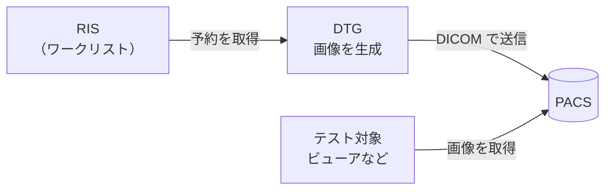

# DICOM Test Data Generator

## 概要

DICOM Test Data Generator（DTG）は、架空の患者の DICOM 画像を生成して PACS へ送信する
テスト用のツールです。CT などのモダリティとして動作し、ワークリストを取得して、
予約の内容で生成した画像を送信します。PACS・RIS・ビューアを、本物の患者のデータを
使わずにテストするために使います。



## 注意

- **医療機器ではありません。** 画像は合成したもので、診断・医療行為・臨床評価・
  AI の学習には使えません
- 本番の PACS には送信せず、テスト用の PACS・RIS にだけ接続してください
- 本ソフトウェアの使用によって生じたいかなる損害についても、作者は責任を負いません

## クイックスタート

Python 3.10 以上で、リポジトリのディレクトリで実行します。

```bash
pip install -r requirements.txt
python -m app.web
python -m app.cli quick -p P000001 -m ct_generic -s 1 -i 3 -o output/
```

2行目で Web 画面を起動し、<http://127.0.0.1:8080/> を開きます。3行目は、架空の
患者の CT 画像を3枚 `output/` に生成します。

## ドキュメント

使い方・仕様・設計の判断は [docs/README.md](docs/README.md) から辿れます。

## ライセンス

MIT License
