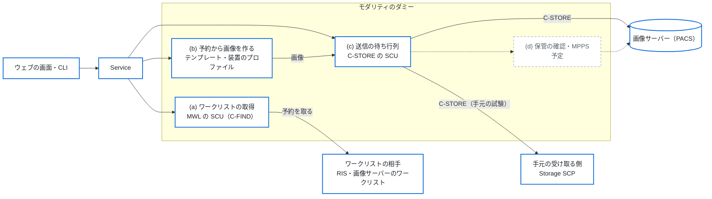
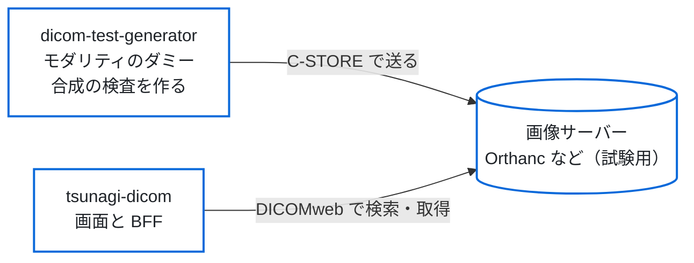

# DICOM Test Data Generator

DICOMテストデータ生成ツール

A tool to generate synthetic and abnormal DICOM datasets
for testing medical imaging systems.
Pixel data is synthetic and not intended for clinical use.

---

## 概要

**DICOM Test Data Generator** は、医療画像システム
（PACS、RIS、ビューア、画像取り込みシステムなど）の
検証・開発・デバッグ用途のために、
人工的な DICOM データを作って送るツールです。
モダリティの代わりに、ワークリストを取得し、予約の値で画像を作り、
画像サーバー（PACS）へ送ることもできます。

生成されるピクセルデータは人工的に作成されたものであり、実際の医療画像を表すものではありません。
そのため、個人情報を含まず、安全にテスト用途へ利用できます。

本ツールは以下のような用途を想定しています：

* DICOM取り込み機能の検証
* PACS連携テスト
* 異常データ耐性テスト
* ネットワーク通信テスト
* 医療システム開発時のデバッグ

---

## システム構成

### 図1　全体

ウェブの画面と CLI は、同じ Service を呼ぶ。ワークリストの相手から予約を取り、
予約の値で合成の画像を作り、画像サーバー（PACS）へ送る。
点線の部分は予定（「これからの予定」）。
レイヤー構造の図は [spec/01_architecture.md](spec/01_architecture.md) にある。



### 試しに使う組み合わせ

モダリティのダミー（この道具）で合成の検査を画像サーバーへ送り、
[tsunagi-dicom](https://github.com/jeysunit/tsunagi-dicom) で見る。
実の患者のデータは使わない。



---

## できること

いま使える機能です。

### DICOM データを作る

* Study / Series / Instance の階層構造と、UID（UUIDベース）、マルチスライスの空間座標、Transfer Syntax の選択
* 日本語の患者名（Specific Character Set、Alphabetic / Ideographic / Phonetic の多言語PN表現）
* ピクセルの生成：簡易モード（テキスト表示）、CT風モード（16bit HU値）。いずれも実画像ではありません
* 異常データの生成：必須タグ欠落、VR違反、文字数超過、不正UID、フォーマット違反など。異常のレベルを設定できます
* モダリティテンプレート、病院設定テンプレート、YAML の Job による構成
* 装置のプロファイル：装置のコンフォーマンスステートメントを読んで写し、
  その装置の DICOM の出し方を擬態します。実在の装置のプロファイルは
  リポジトリの外に置きます（[spec/13_device_profiles.md](spec/13_device_profiles.md)）

### モダリティの代わりをする

ウェブの画面と CLI で、ワークリストの取得、予約を選ぶ、撮る（合成の画像）、PACS へ送る、確かめる、を流します
（[spec/12_modality_emulator.md](spec/12_modality_emulator.md)）。
起動のしかたは下の「モダリティのダミーのウェブの画面」です。
試験用の PACS・RIS にだけつないでください。

* ワークリストの取得（MWL の SCU）
* 画像の送信（C-STORE）と疎通の確認（C-ECHO）、失敗した送信の待ち行列と再送
* 予約のない緊急の患者の入力

### 受け取る側になる

手元の受け取る側（Storage SCP）を起動して、送った画像を受けられます（`python -m app.cli scp start`）。

---

## これからの予定

* 保管の確認（Storage Commitment）：画像を送った後に、相手が保管したことを確かめる
* MPPS：撮影の始まりと終わりを相手に知らせる

PySide6 のデスクトップ画面（`python -m app.gui`）は基本の生成だけを備えています。機能は増やさず、ウェブの画面を使います。

---

## 想定利用者

* 医療システムエンジニア
* PACS開発者
* DICOM開発者
* 医療機器ソフトウェア開発者
* QA / テストエンジニア

---

## 動作環境

* Python 3.10 以上
* Windows / Linux / macOS

推奨：

* Python 3.11+

---

## インストール

```bash
git clone https://github.com/jeysunit/dicom-test-generator.git
cd dicom-test-generator

# 仮想環境の作成・有効化
python -m venv .venv

# Linux / macOS
source .venv/bin/activate

# Windows (PowerShell)
.venv\Scripts\Activate.ps1

# 依存パッケージのインストール
pip install -r requirements.txt
```

---

## 基本的な使い方（CLI）

```bash
# Job YAMLからDICOM生成
python -m app.cli generate examples/job_minimal.yaml

# 出力先を指定して生成
python -m app.cli generate examples/job_full.yaml -o output/ --verbose

# 設定検証のみ（生成なし）
python -m app.cli validate examples/job_minimal.yaml

# CLI引数のみで簡易生成
python -m app.cli quick -p P000001 -m ct_generic -s 3 -i 1,20,20 -o output/

# バージョン表示
python -m app.cli version
```

Job YAML に生成条件を記述します。`examples/` に最小構成・全オプション構成のサンプルがあります。

---

## Job設定例

```yaml
job_name: "テスト生成"
output_dir: "output/test"

patient:
  patient_id: "TEST001"
  patient_name:
    alphabetic: "YAMADA^TARO"
  birth_date: "20000101"
  sex: "M"

study:
  accession_number: "ACC000001"
  study_date: "20240115"
  study_time: "120000"
  num_series: 1

series_list:
  - series_number: 1
    num_images: 10

modality_template: "ct_generic"
pixel_spec:
  mode: "simple_text"

transfer_syntax:
  uid: "1.2.840.10008.1.2"
  name: "Implicit VR Little Endian"
  is_implicit_vr: true
  is_little_endian: true

character_set:
  specific_character_set: ""       # 日本語名の場合: "ISO 2022 IR 6\\ISO 2022 IR 87"
  use_ideographic: false            # 日本語名の場合: true
  use_phonetic: false               # 日本語名の場合: true
```

---

## モダリティのダミーのウェブの画面

ワークリスト・撮影・PACS・設定の4つの画面で「取得→選ぶ→撮る→送る→確かめる」を
流します（[spec/12_modality_emulator.md](spec/12_modality_emulator.md) の 10 章）。
試験用の PACS・RIS にだけつないでください。

### 起動

```bash
# 設定は config/app_config.yaml の modality: と web: の節
python -m app.web
python -m app.web --config config/app_config.yaml
```

ブラウザで <http://127.0.0.1:8080/> を開きます。既定は手元（127.0.0.1）だけで
待ち受け、認証はありません。Node も Tailwind CSS の実行ファイルも要りません
（作った CSS と htmx を `app/web/static/` に置いてあります）。

### 網に出すとき

`web.bind_address` を手元の外（`0.0.0.0` など）にするときは HTTP Basic が必須です。
パスワードを1行だけ書いたファイルを作り、環境の変数で指します。ファイルが無い・空なら
起動しません（終了コード 2）。利用者の名前は `dtg` です。

```bash
DTG_WEB_PASSWORD_FILE=/path/to/password.txt python -m app.web
```

* パスワードは設定のファイルに書きません
* この画面は HTTPS を持ちません。網に出すときは、前段の逆プロキシで TLS を付けてください
  （`Host` の見出しをそのまま渡す設定にします）
* 書き込みの要求は、同じ origin と CSRF の token のときだけ受けます

### 画面の静的な物の出どころ

| 物 | 版 | 取得の元 | sha256 |
|----|----|----------|--------|
| htmx（`app/web/static/htmx.min.js`） | v2.0.9 | GitHub の bigskysoftware/htmx の releases | `57d9191515339922bd1356d7b2d80b1ee3b29f1b3a2c65a078bb8b2e8fd9ae5f` |
| Lucide のアイコン（`app/web/static/icons/`。ISC License、同じ所に `LICENSE`） | 1.48.0 | GitHub の lucide-icons/lucide の releases（`lucide-icons-1.48.0.zip`） | `e27a6b58bebc563581f89668a5a652782075a85a07568e4fd8051a17ce81dba6`（zip） |
| Tailwind CSS の standalone の実行ファイル（CSS を作るときだけ） | v4.3.3 | GitHub の tailwindlabs/tailwindcss の releases | `scripts/build_css.sh` に OS ごとに固定 |

取り直す・作り直すときは次を流します。どちらも sha256 が合わなければ止まります。

```bash
bash scripts/fetch_web_assets.sh   # htmx と Lucide のアイコン
bash scripts/build_css.sh          # app/web/styles/input.css から app/web/static/app.css
```

CI は CSS を作り直し、commit した `app.css` と差が無いことを確かめます。

---

## 注意

* **医療機器ではありません。** 研究・開発・テスト用途だけを目的として提供しています。次の用途には使いません：診断、医療行為、臨床評価、AI学習用の医療画像の生成
* 生成される DICOM データは合成データであり、臨床利用できません
* 本番の PACS には送らず、試験用の PACS・RIS にだけつないでください
* 本ソフトウェアの使用によって発生したいかなる損害についても、作者は責任を負いません

---

## 作る側の資料

開発の段階（Phase）と完了の線は [WORKFLOW.md](WORKFLOW.md) にあります。仕様は `spec/`、設計判断は `adr/` です。

## プロジェクト構成

```text
dicom-test-generator/
├── app/
│   ├── core/           # Core Engine（データモデル、DICOM構築、UID生成等）
│   ├── services/       # Service Layer（テンプレート読み込み、患者検索、生成）
│   ├── cli/            # CLI（argparse、サブコマンド、進捗表示）
│   ├── modality/       # モダリティのダミー（ワークリスト、送信、待ち行列）
│   ├── scp/            # Storage SCP（受け取る側）
│   ├── web/            # ウェブの画面
│   └── gui/            # PySide6 のデスクトップ画面（基本の生成だけ）
├── tests/
│   ├── core/           # Core Engineテスト
│   ├── services/       # Service Layerテスト
│   └── cli/            # CLIテスト
├── spec/               # 仕様書
├── adr/                # 設計判断記録
├── docs/               # MkDocsドキュメント
├── templates/          # モダリティ・病院テンプレート（YAML）
├── profiles/examples/  # 架空の装置のプロファイルの例（実在の装置は外に置く）
├── data/               # 患者マスターデータ
├── examples/           # Job YAML設定例
└── README.md           # 本ファイル
```

---

## 開発方針

本プロジェクトは仕様駆動開発を採用しています。

* Core Engine を中心としたレイヤー構造
* CLI、ウェブの画面、通信の順に段階を踏んだ開発
* ADRによる設計判断の記録

詳細は `spec/` ディレクトリを参照してください。

---

## ドキュメント

仕様書は `spec/` ディレクトリにあります。

### 主要ドキュメント

* [00_overview.md](spec/00_overview.md) - プロジェクト概要
* [01_architecture.md](spec/01_architecture.md) - アーキテクチャ設計
* [02_core_engine.md](spec/02_core_engine.md) - Core Engine API
* [07_job_schema.md](spec/07_job_schema.md) - Job YAML スキーマ

### MkDocsでドキュメント表示

```bash
pip install mkdocs mkdocs-material
mkdocs serve
# http://127.0.0.1:8000
```

---

## ライセンス

MIT License

---

## 作者

医療ITシステムエンジニアによって開発

---

## 貢献

Issue / Pull Request を歓迎します。

Repository: <https://github.com/jeysunit/dicom-test-generator>

---

## 関連情報

* DICOM Standard: <https://www.dicomstandard.org/>
* PyDicom: <https://pydicom.github.io/>
* PyNetDICOM: <https://pydicom.github.io/pynetdicom/>

---
