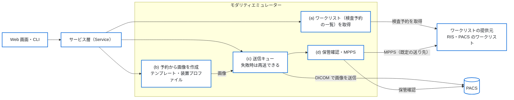

# DICOM Test Data Generator

DICOMテストデータ生成ツール

A tool to create DICOM datasets of made-up patients, including deliberately
abnormal ones, for testing medical imaging systems.
Pixel data is made up for testing and not intended for clinical use.

---

## 概要

**DICOM Test Data Generator** は、医療画像システム
（PACS、RIS、ビューア、画像取り込みシステムなど）の
検証・開発・デバッグ用途のために、
架空の患者の試験用 DICOM データを作成・送信するツールです。
CT などの検査装置（モダリティ）として動作し、ワークリスト（検査予約の一覧）を取得して、
予約の内容で作成した画像を PACS へ送信することもできます。

画像の中身は試験用に生成したもので、実際の医療画像ではありません。
そのため、個人情報を含まず、安全にテスト用途へ利用できます。

本ツールは以下のような用途を想定しています：

* DICOM取り込み機能の検証
* PACS連携テスト
* 異常データ耐性テスト
* ネットワーク通信テスト
* 医療システム開発時のデバッグ

---

## システム構成

### 全体の構成

この図で分かること：本ツールの内部の処理の流れと、外部のシステム（ワークリストの提供元、
PACS）との接続。

Web 画面と CLI は、同じサービス層（Service）を呼び出す。
ワークリストの提供元から検査予約を取得し、予約の内容で試験用の画像を作成して、
PACS へ送信する。送信後の保管確認（Storage Commitment）と
MPPS は、設定で有効にしたときだけ行う。
内部のレイヤー構成の図は [spec/01_architecture.md](spec/01_architecture.md) にある。



---

## できること

いま使える機能です。

### DICOM データを作る

* Study / Series / Instance の階層構造と、UID（UUIDベース）、マルチスライスの空間座標、Transfer Syntax の選択
* 日本語の患者名（Specific Character Set、Alphabetic / Ideographic / Phonetic の多言語PN表現）
* ピクセルの生成：簡易モード（テキスト表示）、CT風モード（16bit HU値）。いずれも実画像ではありません
* 異常データの生成：必須タグ欠落、VR違反、文字数超過、不正UID、Pixel Data 欠落。
  レベル（none / mild / moderate / severe）は Job YAML の `abnormal.level` か
  `--abnormal-level` で選びます。指定しなければ正常なデータです
* モダリティテンプレート、病院設定テンプレート、YAML の Job による構成
* 装置プロファイル：装置の DICOM コンフォーマンスステートメントの内容を写し、
  その装置の DICOM の出力を再現します。実在の装置のプロファイルは
  リポジトリの外に置きます（[spec/13_device_profiles.md](spec/13_device_profiles.md)）

### モダリティとして動作する

Web 画面と CLI で、ワークリストの取得、予約の選択、撮影（試験用画像の作成）、
PACS への送信、結果の確認までを行います
（[spec/12_modality_emulator.md](spec/12_modality_emulator.md)）。
起動方法は下の「モダリティエミュレーターの Web 画面」を見てください。
試験用の PACS・RIS にだけつないでください。

* ワークリスト（検査予約の一覧）の取得（MWL）
* 画像の送信（C-STORE）、疎通確認（C-ECHO）、失敗した送信のキューと再送
* 予約のない緊急検査の患者の入力
* 保管確認（Storage Commitment）：送信した画像を相手が保管したかを問い合わせる。有効にしたときだけ
  （下の「保管確認と MPPS」）
* MPPS：撮影の開始と終了を相手に通知する。有効にしたときだけ

画像を受信して保存する機能（Storage SCP）はありません。受信側には
試験用の PACS（Orthanc など）を用意してください
（[ADR-0013](adr/0013-remove-storage-scp.md)）。

PySide6 のデスクトップ画面（`python -m app.gui`）は基本の生成機能だけを持ち、
機能追加を止めています。今後は Web 画面を使ってください
（[spec/05_gui.md](spec/05_gui.md)）。

---

## 想定利用者

* 医療システムエンジニア
* PACS開発者
* DICOM開発者
* 医療機器ソフトウェア開発者
* QA / テストエンジニア

---

## 動作環境

* Python 3.10 以上
* Windows / Linux / macOS

推奨：

* Python 3.11+

---

## インストール

```bash
git clone https://github.com/jeysunit/dicom-test-generator.git
cd dicom-test-generator

# 仮想環境の作成・有効化
python -m venv .venv

# Linux / macOS
source .venv/bin/activate

# Windows (PowerShell)
.venv\Scripts\Activate.ps1

# 依存パッケージのインストール
pip install -r requirements.txt
```

### Docker で動かす

`Dockerfile` で、CLI と Web 画面のイメージを作れます（GUI は入りません）。
コンテナは root 以外のユーザー（uid 10001）で動きます。

```bash
docker build -t dicom-test-generator .
```

設定ファイルはコンテナの外に置き、`/app/config/app_config.yaml` に
mount します。Web 画面はコンテナの中で `0.0.0.0` に bind するので、
設定の `web.bind_address` を `"0.0.0.0"` にし、HTTP Basic 認証の
パスワードのファイルを渡します（「ネットワークに公開するとき」）。
設定ファイルとパスワードのファイルは、リポジトリの外（例：`~/dtg/`）に
置きます。次の例は、ポートをホストの 127.0.0.1 にだけ公開します。

```bash
docker run -d --name dtg -p 127.0.0.1:8080:8080 \
  -v "$HOME/dtg/app_config.yaml:/app/config/app_config.yaml:ro" \
  -v "$HOME/dtg/password.txt:/run/secrets/dtg_web_password:ro" \
  -e DTG_WEB_PASSWORD_FILE=/run/secrets/dtg_web_password \
  -v dtg-state:/app/modality_state -v dtg-output:/app/output \
  dicom-test-generator

# CLI は同じコンテナの中で動かす
docker exec dtg python -m app.cli echo --to PACS_TEST
```

* 送信先とワークリストの相手は、設定ファイルの `modality:` の節に書きます。
  コンテナから届くホスト名か IP アドレスにします
* 予約の結果と送信のキューは `/app/modality_state`、作った画像は
  `/app/output` に書きます。残すときは volume を mount します
* パスワードのファイルは、コンテナの中のユーザー（uid 10001）が
  読めるようにします（例：`chmod 0644`）
* volume の代わりにホストのディレクトリを bind mount するときは、
  そのディレクトリを uid 10001 が書き込めるようにします
* この手順では、保管確認（Storage Commitment）の結果は受け取れません。
  受け取るには、設定の `modality.listen.bind_address` を `"0.0.0.0"` にし、
  待ち受けのポート（既定 11113）も公開します
* イメージにヘルスチェックは入れていません

---

## 基本的な使い方（CLI）

```bash
# Job YAMLからDICOM生成
python -m app.cli generate examples/job_minimal.yaml

# 出力先を指定して生成
python -m app.cli generate examples/job_full.yaml -o output/ --verbose

# 設定検証のみ（生成なし）
python -m app.cli validate examples/job_minimal.yaml

# CLI引数のみで簡易生成
python -m app.cli quick -p P000001 -m ct_generic -s 3 -i 1,20,20 -o output/

# 異常のデータを作る（none / mild / moderate / severe）
python -m app.cli quick -p P000001 -m ct_generic -s 1 -i 5 -o output/ --abnormal-level mild

# バージョン表示
python -m app.cli version
```

Job YAML に生成条件を記述します。`examples/` に最小構成・全オプション構成のサンプルがあります。
引数の詳細は各サブコマンドの `--help` を見てください
（[spec/04_cli.md](spec/04_cli.md)）。

---

## Job設定例

```yaml
job_name: "テスト生成"
output_dir: "output/test"

patient:
  patient_id: "TEST001"
  patient_name:
    alphabetic: "YAMADA^TARO"
  birth_date: "20000101"
  sex: "M"

study:
  accession_number: "ACC000001"
  study_date: "20240115"
  study_time: "120000"
  num_series: 1

series_list:
  - series_number: 1
    num_images: 10

modality_template: "ct_generic"
pixel_spec:
  mode: "simple_text"

transfer_syntax:
  uid: "1.2.840.10008.1.2"
  name: "Implicit VR Little Endian"
  is_implicit_vr: true
  is_little_endian: true

character_set:
  specific_character_set: ""       # 日本語名の場合: "ISO 2022 IR 6\\ISO 2022 IR 87"
  use_ideographic: false            # 日本語名の場合: true
  use_phonetic: false               # 日本語名の場合: true
```

---

## モダリティエミュレーターの Web 画面

ワークリスト・撮影・PACS・設定の4つの画面で「取得 → 選択 → 撮影 → 送信 → 確認」を
行います（[spec/12a_web_screens_and_cli.md](spec/12a_web_screens_and_cli.md) の
10 章）。試験用の PACS・RIS にだけつないでください。

### 起動

```bash
# 設定は config/app_config.yaml の modality: と web: の節
python -m app.web
python -m app.web --config config/app_config.yaml
```

ブラウザで <http://127.0.0.1:8080/> を開きます。既定ではローカル（127.0.0.1）だけで
待ち受け、認証はありません。Node も Tailwind CSS の実行ファイルも不要です
（ビルド済みの CSS と htmx を `app/web/static/` に置いてあります）。

### ネットワークに公開するとき

`web.bind_address` をローカル以外（`0.0.0.0` など）にするときは HTTP Basic 認証が必須です。
パスワードを1行だけ書いたファイルを作り、環境変数で指定します。ファイルが無いか空のときは
起動しません（終了コード 2）。ユーザー名は `dtg` です。

```bash
DTG_WEB_PASSWORD_FILE=/path/to/password.txt python -m app.web
```

* パスワードは設定ファイルに書きません
* この画面は HTTPS に対応していません。ネットワークに公開するときは、前段のリバースプロキシで TLS を終端してください
  （`Host` ヘッダーをそのまま渡す設定にします）
* 書き込み系のリクエストは、同一オリジンで CSRF トークンが正しいときだけ受け付けます

### 画面の静的ファイルの入手元

| ファイル | バージョン | 入手元 | sha256 |
|----|----|----------|--------|
| htmx（`app/web/static/htmx.min.js`） | v2.0.9 | GitHub の bigskysoftware/htmx の releases | `57d9191515339922bd1356d7b2d80b1ee3b29f1b3a2c65a078bb8b2e8fd9ae5f` |
| Lucide のアイコン（`app/web/static/icons/`。ISC License、同じ所に `LICENSE`） | 1.48.0 | GitHub の lucide-icons/lucide の releases（`lucide-icons-1.48.0.zip`） | `e27a6b58bebc563581f89668a5a652782075a85a07568e4fd8051a17ce81dba6`（zip） |
| Tailwind CSS の standalone の実行ファイル（CSS を作るときだけ） | v4.3.3 | GitHub の tailwindlabs/tailwindcss の releases | `scripts/build_css.sh` に OS ごとに固定 |

再取得・再ビルドするときは次を実行します。どちらも sha256 が一致しなければ止まります。

```bash
bash scripts/fetch_web_assets.sh   # htmx と Lucide のアイコン
bash scripts/build_css.sh          # app/web/styles/input.css から app/web/static/app.css
```

CI は CSS を再ビルドし、コミット済みの `app.css` と差分が無いことを確認します。

---

## 保管確認と MPPS

どちらも既定では無効です。`config/app_config.yaml` の `modality:` セクションで有効にします
（[spec/12_modality_emulator.md](spec/12_modality_emulator.md) の 8.3・8.4・12 章）。

### 保管確認（Storage Commitment）

```yaml
modality:
  listen:                       # 結果（N-EVENT-REPORT）を受信する待ち受け
    bind_address: "127.0.0.1"
    port: 11113
  destinations:
    - name: "PACS_TEST"
      ae_title: "PACS_TEST"
      host: "127.0.0.1"
      port: 4242
      storage_commitment: true
      commitment_timeout_seconds: 600   # 結果を待つ秒数
      commitment_wait_seconds: 0        # 同じ Association で待つ秒数（0 は待たない）
```

* Web 画面（`python -m app.web`）は待ち受けを起動し、送信に成功した画像の保管確認を
  すぐに要求します。PACS 画面の送信キューの「保管確認」の列に、確認待ち・確認済・
  確認失敗・確認タイムアウトが表示されます
* CLI では自動で要求しません。送信後に `commit` で要求し、結果を待ちます。確認済なら
  終了コード 0、それ以外は 5 です。Web 画面が同じポートで待ち受けているときは
  待ち受けを起動できないため、終了コード 2 で止まります

```bash
python -m app.cli exam --emergency --patient-id E0001 --patient-name "KINKYU^TARO" --send
python -m app.cli queue list               # ジョブの ID と COMMIT の列
python -m app.cli commit --job 1 --wait 60
```

* 結果は、相手が別の Association で返すことを前提にしています。同じ Association でしか
  返さない相手のときだけ、`commitment_wait_seconds` に秒数を設定します

### 試験用の Orthanc で確かめる手順

この手順の動作確認は、まだ済んでいません（[WORKFLOW.md](WORKFLOW.md) の Phase 3c）。

Orthanc（1.6.0 以降）は保管確認を受け付け、結果を別の Association で返します。結果の返送
先として、本ツールを Orthanc の設定の `DicomModalities` に登録します。

1. Orthanc の設定に、本ツールの AE タイトル・IP アドレス・待ち受けのポートを追加します
   （例：`"DicomModalities": { "dtg": [ "DTG_CT01", "127.0.0.1", 11113 ] }`）。
   Orthanc をコンテナで動かすときは、コンテナから到達できる IP アドレスを書き、本ツールの
   `listen.bind_address` もそのアドレスで待ち受けるようにします（既定の 127.0.0.1 では
   コンテナから到達できません）
2. 本ツールの送信先を Orthanc の AE タイトル・IP アドレス・DICOM ポートにし、
   `storage_commitment: true` にします
3. `python -m app.web` を起動し、撮影画面で [撮影して送る] を押します
4. PACS 画面の送信キューで、そのジョブの「保管確認」が「確認済」になることを確認します。
   CLI では、Web 画面を止めてから `python -m app.cli commit --job <ID>` で「confirmed」と
   終了コード 0 を確認します

### MPPS

```yaml
modality:
  worklist:
    use_mpps: true              # MPPS を送る
  mpps:                         # 省略時はワークリストの提供元へ送る
    ae_title: "MPPS_TEST"
    host: "127.0.0.1"
    port: 4243
    timeout_seconds: 30
```

* 撮影開始時に N-CREATE（IN PROGRESS）、画像の作成完了時に N-SET（COMPLETED）を送ります。
  作成の途中で中断したときは N-SET（DISCONTINUED）を送ります
* MPPS を送れなくても、撮影と画像の送信は止めません。撮影画面と CLI（`[WARN] MPPS ...`）に表示し、
  通知をキューに残します。`retry.max_attempts` の回数だけすぐに再送し、残りは
  `mpps retry` で送ります
* `exam --mpps`・`--no-mpps` で、その撮影だけ設定を上書きできます。装置プロファイルが
  `services.mpps: false` なら送りません
* Orthanc は MPPS を受け付けません。MPPS を受け付ける試験用の相手（RIS など）を使ってください

```bash
python -m app.cli mpps list
python -m app.cli mpps retry
```

---

## 注意

* **医療機器ではありません。** 研究・開発・テスト用途だけを目的として提供しています。次の用途には使いません：診断、医療行為、臨床評価、AI学習用の医療画像の生成
* 生成される DICOM データは架空の試験用データであり、臨床利用できません
* 本番の PACS には送信せず、試験用の PACS・RIS にだけ接続してください
* 本ソフトウェアの使用によって発生したいかなる損害についても、作者は責任を負いません

---

## 開発者向けの資料

開発のフェーズと完了条件は [WORKFLOW.md](WORKFLOW.md) にあります。仕様は `spec/`、設計判断は `adr/` です。

### プロジェクト構成

```text
dicom-test-generator/
├── app/
│   ├── core/           # Core Engine（データモデル、DICOM構築、UID生成等）
│   ├── services/       # Service Layer（テンプレート読み込み、患者検索、生成）
│   ├── modality/       # モダリティエミュレーター（ワークリスト、送信、キュー、保管確認、MPPS）
│   ├── cli/            # CLI（argparse、サブコマンド、進捗表示）
│   ├── web/            # Web 画面
│   └── gui/            # PySide6 のデスクトップ画面（基本の生成機能のみ。機能追加は停止）
├── tests/              # core・services・cli・modality・web・gui・integration
├── spec/               # 仕様書
├── adr/                # 設計判断記録
├── config/             # 設定（app_config.yaml）
├── templates/          # モダリティ・病院テンプレート（YAML）
├── profiles/examples/  # 架空の装置プロファイルの例（実在の装置のものはリポジトリ外に置く）
├── data/               # 患者マスターデータ
├── examples/           # Job YAML設定例
└── README.md           # 本ファイル
```

### 開発方針

本プロジェクトは仕様駆動開発を採用しています。

* Core Engine を中心としたレイヤー構造
* CLI、Web 画面、通信の順に段階を踏んだ開発
* ADRによる設計判断の記録

### 仕様書を読む順

1. [00_overview.md](spec/00_overview.md) - プロジェクト概要
2. [01_architecture.md](spec/01_architecture.md) - アーキテクチャ設計
3. [02_core_engine.md](spec/02_core_engine.md) - Core Engine API
4. [07_job_schema.md](spec/07_job_schema.md) - Job YAML スキーマ
5. [12_modality_emulator.md](spec/12_modality_emulator.md) - モダリティエミュレーター
   （Web 画面と CLI は [12a](spec/12a_web_screens_and_cli.md)、設計判断と制約は
   [12b](spec/12b_decisions_and_limits.md)）

---

## ライセンス

MIT License

---

## 作者

医療ITシステムエンジニアによって開発

---

## 貢献

Issue / Pull Request を歓迎します。

Repository: <https://github.com/jeysunit/dicom-test-generator>

---

## 関連情報

* DICOM Standard: <https://www.dicomstandard.org/>
* PyDicom: <https://pydicom.github.io/>
* PyNetDICOM: <https://pydicom.github.io/pynetdicom/>

---
