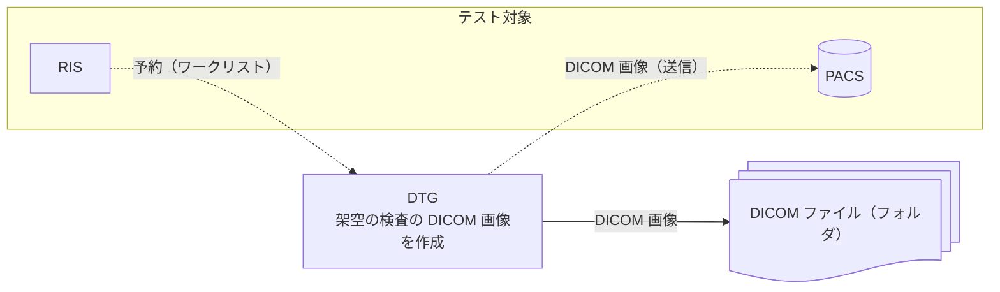

# DICOM Test Data Generator

## 概要

DICOM Test Data Generator（DTG）は、架空の患者の架空の検査の DICOM 画像を作成する
ツールです。作成した画像は、本物の患者のデータを使わずに PACS・RIS・ビューアを
テストするために使います。

主な機能は、DICOM 画像を作成して、フォルダにファイルとして保存することです。
補助の機能として、モダリティのように振る舞うこともできます。RIS からワークリストを
取得して予約の内容で画像を作成し、PACS へ送信します。操作は CLI と Web 画面で
行います。

図の実線は主な機能、点線は補助の機能です。矢印はデータが流れる向きです。



## 注意

- **医療機器ではありません。** 画像は合成したもので、診断・医療行為・臨床評価・
  AI の学習には使えません
- 本番の PACS には送信せず、テスト用の PACS・RIS にだけ接続してください
- 本ソフトウェアの使用によって生じたいかなる損害についても、作者は責任を負いません
- 画像に書く Implementation Class UID と Instance Creator UID は、2.25（UUID 派生）の
  固定の値を使っています（`app/services/study_generator.py` の
  `IMPLEMENTATION_CLASS_UID`・`INSTANCE_CREATOR_UID`）。DICOM PS3.5 の
  [B.2](https://dicom.nema.org/medical/dicom/current/output/chtml/part05/sect_B.2.html)
  は、設計時に決める固定の UID には、UUID 派生を通常は勧めていません。製品として配る
  ときは、登録した根（例：IANA の Private Enterprise Number）に替える予定です

## クイックスタート

Docker で実行します。作業用のフォルダに、Web 画面のパスワードを1行だけ書いた
ファイル `password.txt` を作ってから、次を実行します。

```bash
mkdir -p output
docker run -d --name dtg --user "$(id -u):$(id -g)" -p 127.0.0.1:8080:8080 -v "$PWD/password.txt:/run/secrets/dtg_web_password:ro" -e DTG_WEB_PASSWORD_FILE=/run/secrets/dtg_web_password -v "$PWD/output:/app/output" -v dtg-state:/app/modality_state ghcr.io/jeysunit/dicom-test-generator:latest
docker exec dtg python -m app.cli quick -p P000001 -m ct_generic -s 1 -i 3 -o /app/output
```

2行目でイメージを取得して Web 画面を起動します。<http://127.0.0.1:8080/> を開き、
ユーザー名 `dtg` とパスワードでログインします。3行目は、架空の患者の CT 画像を3枚
`output/` に作成します。送信先の設定と CLI の使い方は
[docs/usage.md](docs/usage.md) にあります。

## ドキュメント

使い方・仕様・設計の判断は [docs/README.md](docs/README.md) から辿れます。

## ライセンス

MIT License
