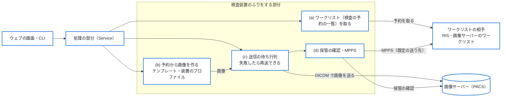
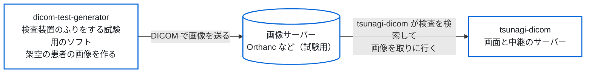

# DICOM Test Data Generator

DICOMテストデータ生成ツール

A tool to create DICOM datasets of made-up patients, including deliberately
abnormal ones, for testing medical imaging systems.
Pixel data is made up for testing and not intended for clinical use.

---

## 概要

**DICOM Test Data Generator** は、医療画像システム
（PACS、RIS、ビューア、画像取り込みシステムなど）の
検証・開発・デバッグ用途のために、
試験用に作った架空の患者の DICOM データを作って送るツールです。
CT などの検査装置（モダリティ）のふりをして、ワークリスト（検査の予約の一覧）を取り、
予約の値で画像を作り、画像サーバー（PACS）へ送ることもできます。

画像の中身は試験用に作ったもので、実際の医療画像ではありません。
そのため、個人情報を含まず、安全にテスト用途へ利用できます。

本ツールは以下のような用途を想定しています：

* DICOM取り込み機能の検証
* PACS連携テスト
* 異常データ耐性テスト
* ネットワーク通信テスト
* 医療システム開発時のデバッグ

---

## システム構成

### 図1　全体

この図で分かること：このソフトの中の流れと、外の装置・仕組み（ワークリストの相手、
画像サーバー）とのつながり。

ウェブの画面と CLI（コマンドの画面）は、同じ処理の部分（Service）を呼ぶ。
ワークリストの相手から予約を取り、予約の値で試験用の画像を作り、
画像サーバー（PACS）へ送る。送った後に、保管の確認（Storage Commitment）と
MPPS を、設定で選んだときだけ行う。
内部の層の図は [spec/01_architecture.md](spec/01_architecture.md) にある。



### 図2　開発・試験のときの構成（本物の患者のデータを使わずに試す）

この図で分かること：試験のときに、画像を見るソフト（tsunagi-dicom）と組み合わせる構成。

このソフトで、CT などの検査装置のふりをして、試験用に作った架空の患者の画像を
画像サーバーへ送り、[tsunagi-dicom](https://github.com/jeysunit/tsunagi-dicom)
で見る。本物の患者のデータは使わない。



矢印は、画像が流れる向きを表す。

---

## できること

いま使える機能です。

### DICOM データを作る

* Study / Series / Instance の階層構造と、UID（UUIDベース）、マルチスライスの空間座標、Transfer Syntax の選択
* 日本語の患者名（Specific Character Set、Alphabetic / Ideographic / Phonetic の多言語PN表現）
* ピクセルの生成：簡易モード（テキスト表示）、CT風モード（16bit HU値）。いずれも実画像ではありません
* 異常データの生成：必須タグ欠落、VR違反、文字数超過、不正UID、Pixel Data 欠落。
  レベル（none / mild / moderate / severe）は Job YAML の `abnormal.level` か
  `--abnormal-level` で選びます。指定しなければ正常なデータです
* モダリティテンプレート、病院設定テンプレート、YAML の Job による構成
* 装置のプロファイル：装置のコンフォーマンスステートメントを読んで写し、
  その装置の DICOM の出し方を擬態します。実在の装置のプロファイルは
  リポジトリの外に置きます（[spec/13_device_profiles.md](spec/13_device_profiles.md)）

### モダリティの代わりをする

ウェブの画面と CLI で、ワークリストを取る、予約を選ぶ、撮る（試験用の画像）、
PACS へ送る、確かめる、を流します
（[spec/12_modality_emulator.md](spec/12_modality_emulator.md)）。
起動のしかたは下の「検査装置のふりをするウェブの画面」です。
試験用の PACS・RIS にだけつないでください。

* ワークリスト（検査の予約の一覧）を取る（MWL）
* 画像を送る（C-STORE）、つながるかを確かめる（C-ECHO）、失敗した送信の待ち行列と再送
* 予約のない緊急の患者の入力
* 保管の確認（Storage Commitment）：送った画像を相手が保管したかを問う。選んだときだけ
  （下の「保管の確認と MPPS」）
* MPPS：撮影の始まりと終わりを相手に知らせる。選んだときだけ

画像を受け取って保存する機能（Storage SCP）はありません。受け取る側は、
試験用の PACS（Orthanc など）を用意してください
（[ADR-0013](adr/0013-remove-storage-scp.md)）。

PySide6 のデスクトップ画面（`python -m app.gui`）は、基本の生成だけを備えた
凍結の機能です。機能は増やさず、ウェブの画面を使います
（[spec/05_gui.md](spec/05_gui.md)）。

---

## 想定利用者

* 医療システムエンジニア
* PACS開発者
* DICOM開発者
* 医療機器ソフトウェア開発者
* QA / テストエンジニア

---

## 動作環境

* Python 3.10 以上
* Windows / Linux / macOS

推奨：

* Python 3.11+

---

## インストール

```bash
git clone https://github.com/jeysunit/dicom-test-generator.git
cd dicom-test-generator

# 仮想環境の作成・有効化
python -m venv .venv

# Linux / macOS
source .venv/bin/activate

# Windows (PowerShell)
.venv\Scripts\Activate.ps1

# 依存パッケージのインストール
pip install -r requirements.txt
```

---

## 基本的な使い方（CLI）

```bash
# Job YAMLからDICOM生成
python -m app.cli generate examples/job_minimal.yaml

# 出力先を指定して生成
python -m app.cli generate examples/job_full.yaml -o output/ --verbose

# 設定検証のみ（生成なし）
python -m app.cli validate examples/job_minimal.yaml

# CLI引数のみで簡易生成
python -m app.cli quick -p P000001 -m ct_generic -s 3 -i 1,20,20 -o output/

# 異常のデータを作る（none / mild / moderate / severe）
python -m app.cli quick -p P000001 -m ct_generic -s 1 -i 5 -o output/ --abnormal-level mild

# バージョン表示
python -m app.cli version
```

Job YAML に生成条件を記述します。`examples/` に最小構成・全オプション構成のサンプルがあります。
引数の詳細は各サブコマンドの `--help` を見てください
（[spec/04_cli.md](spec/04_cli.md)）。

---

## Job設定例

```yaml
job_name: "テスト生成"
output_dir: "output/test"

patient:
  patient_id: "TEST001"
  patient_name:
    alphabetic: "YAMADA^TARO"
  birth_date: "20000101"
  sex: "M"

study:
  accession_number: "ACC000001"
  study_date: "20240115"
  study_time: "120000"
  num_series: 1

series_list:
  - series_number: 1
    num_images: 10

modality_template: "ct_generic"
pixel_spec:
  mode: "simple_text"

transfer_syntax:
  uid: "1.2.840.10008.1.2"
  name: "Implicit VR Little Endian"
  is_implicit_vr: true
  is_little_endian: true

character_set:
  specific_character_set: ""       # 日本語名の場合: "ISO 2022 IR 6\\ISO 2022 IR 87"
  use_ideographic: false            # 日本語名の場合: true
  use_phonetic: false               # 日本語名の場合: true
```

---

## 検査装置のふりをするウェブの画面

ワークリスト・撮影・PACS・設定の4つの画面で「取得→選ぶ→撮る→送る→確かめる」を
流します（[spec/12a_web_screens_and_cli.md](spec/12a_web_screens_and_cli.md) の
10 章）。試験用の PACS・RIS にだけつないでください。

### 起動

```bash
# 設定は config/app_config.yaml の modality: と web: の節
python -m app.web
python -m app.web --config config/app_config.yaml
```

ブラウザで <http://127.0.0.1:8080/> を開きます。既定は手元（127.0.0.1）だけで
待ち受け、認証はありません。Node も Tailwind CSS の実行ファイルも要りません
（作った CSS と htmx を `app/web/static/` に置いてあります）。

### 網に出すとき

`web.bind_address` を手元の外（`0.0.0.0` など）にするときは HTTP Basic が必須です。
パスワードを1行だけ書いたファイルを作り、環境の変数で指します。ファイルが無い・空なら
起動しません（終了コード 2）。利用者の名前は `dtg` です。

```bash
DTG_WEB_PASSWORD_FILE=/path/to/password.txt python -m app.web
```

* パスワードは設定のファイルに書きません
* この画面は HTTPS を持ちません。網に出すときは、前段の逆プロキシで TLS を付けてください
  （`Host` の見出しをそのまま渡す設定にします）
* 書き込みの要求は、同じ origin と CSRF の token のときだけ受けます

### 画面の静的な物の出どころ

| 物 | 版 | 取得の元 | sha256 |
|----|----|----------|--------|
| htmx（`app/web/static/htmx.min.js`） | v2.0.9 | GitHub の bigskysoftware/htmx の releases | `57d9191515339922bd1356d7b2d80b1ee3b29f1b3a2c65a078bb8b2e8fd9ae5f` |
| Lucide のアイコン（`app/web/static/icons/`。ISC License、同じ所に `LICENSE`） | 1.48.0 | GitHub の lucide-icons/lucide の releases（`lucide-icons-1.48.0.zip`） | `e27a6b58bebc563581f89668a5a652782075a85a07568e4fd8051a17ce81dba6`（zip） |
| Tailwind CSS の standalone の実行ファイル（CSS を作るときだけ） | v4.3.3 | GitHub の tailwindlabs/tailwindcss の releases | `scripts/build_css.sh` に OS ごとに固定 |

取り直す・作り直すときは次を流します。どちらも sha256 が合わなければ止まります。

```bash
bash scripts/fetch_web_assets.sh   # htmx と Lucide のアイコン
bash scripts/build_css.sh          # app/web/styles/input.css から app/web/static/app.css
```

CI は CSS を作り直し、commit した `app.css` と差が無いことを確かめます。

---

## 保管の確認と MPPS

どちらも既定は使いません。`config/app_config.yaml` の `modality:` の節で選びます
（[spec/12_modality_emulator.md](spec/12_modality_emulator.md) の 8.3・8.4・12 章）。

### 保管の確認（Storage Commitment）

```yaml
modality:
  listen:                       # 結果（N-EVENT-REPORT）を受ける待ち受け
    bind_address: "127.0.0.1"
    port: 11113
  destinations:
    - name: "PACS_TEST"
      ae_title: "PACS_TEST"
      host: "127.0.0.1"
      port: 4242
      storage_commitment: true
      commitment_timeout_seconds: 600   # 結果を待つ秒
      commitment_wait_seconds: 0        # 同じ Association で待つ秒（0 は待たない）
```

* 画面（`python -m app.web`）は待ち受けを立て、送り先へ「送れた」になった件の保管の
  確認をすぐに求めます。PACS の画面の待ち行列の「保管の確認」の列に、確認待ち・確認済・
  確認の失敗・確認の時間切れが出ます
* CLI では自動で求めません。送った後に `commit` で求め、結果を待ちます。確認済なら
  終了コード 0、そうでなければ 5 です。画面が同じ待ち受けのポートで動いているときは
  待ち受けを立てられないので、終了コード 2 で止まります

```bash
python -m app.cli exam --emergency --patient-id E0001 --patient-name "KINKYU^TARO" --send
python -m app.cli queue list               # 件の ID と COMMIT の列
python -m app.cli commit --job 1 --wait 60
```

* 結果は、相手が別の Association で返すのを既定にしています。同じ Association でしか
  返さない相手のときだけ、`commitment_wait_seconds` に秒を入れます

### 試験用の Orthanc で確かめる手順

この手順の手の確かめは、まだ済んでいません（[WORKFLOW.md](WORKFLOW.md) の Phase 3c）。

Orthanc（1.6.0 から）は保管の確認を受け、結果を別の Association で返します。結果を返す
先として、この道具を Orthanc の設定の `DicomModalities` に登録します。

1. Orthanc の設定に、この道具の AE タイトル・住所・待ち受けのポートを足します
   （例：`"DicomModalities": { "dtg": [ "DTG_CT01", "127.0.0.1", 11113 ] }`）。
   Orthanc をコンテナで動かすときは、コンテナから届く住所を書き、この道具の
   `listen.bind_address` もその住所で受けるようにします（既定の 127.0.0.1 では
   コンテナから届きません）
2. この道具の送り先を Orthanc の AE タイトル・住所・DICOM のポートにし、
   `storage_commitment: true` にします
3. `python -m app.web` を起動し、撮影の画面で [撮影して送る] を押します
4. PACS の画面の待ち行列で、その件の「保管の確認」が「確認済」になることを確かめます。
   CLI なら、画面を止めてから `python -m app.cli commit --job <ID>` で「confirmed」と
   終了コード 0 を確かめます

### MPPS

```yaml
modality:
  worklist:
    use_mpps: true              # MPPS を送る
  mpps:                         # 書かなければワークリストの相手へ送る
    ae_title: "MPPS_TEST"
    host: "127.0.0.1"
    port: 4243
    timeout_seconds: 30
```

* 撮影を始めるときに N-CREATE（IN PROGRESS）、作り終わりに N-SET（COMPLETED）を送ります。
  作る途中で止まったら N-SET（DISCONTINUED）を送ります
* 送れなくても撮影と送信は止めません。撮影の画面と CLI（`[WARN] MPPS ...`）に出し、
  知らせを待ち行列に残します。`retry.max_attempts` の回数だけすぐに送り直し、残りは
  `mpps retry` で送ります
* `exam --mpps`・`--no-mpps` で、その撮影だけ設定を上書きできます。装置のプロファイルが
  `services.mpps: false` なら送りません
* Orthanc は MPPS を受けません。MPPS を受ける試験の相手（RIS など）を使ってください

```bash
python -m app.cli mpps list
python -m app.cli mpps retry
```

---

## 注意

* **医療機器ではありません。** 研究・開発・テスト用途だけを目的として提供しています。次の用途には使いません：診断、医療行為、臨床評価、AI学習用の医療画像の生成
* 作られる DICOM データは試験用に作った架空のデータであり、臨床利用できません
* 本番の PACS には送らず、試験用の PACS・RIS にだけつないでください
* 本ソフトウェアの使用によって発生したいかなる損害についても、作者は責任を負いません

---

## 作る側の資料

開発の段階（Phase）と完了の線は [WORKFLOW.md](WORKFLOW.md) にあります。仕様は `spec/`、設計判断は `adr/` です。

### プロジェクト構成

```text
dicom-test-generator/
├── app/
│   ├── core/           # Core Engine（データモデル、DICOM構築、UID生成等）
│   ├── services/       # Service Layer（テンプレート読み込み、患者検索、生成）
│   ├── modality/       # 検査装置のふり（ワークリスト、送信、待ち行列、保管の確認、MPPS）
│   ├── cli/            # CLI（argparse、サブコマンド、進捗表示）
│   ├── web/            # ウェブの画面
│   └── gui/            # PySide6 のデスクトップ画面（基本の生成だけ。凍結）
├── tests/              # core・services・cli・modality・web・gui・integration
├── spec/               # 仕様書
├── adr/                # 設計判断記録
├── config/             # 設定（app_config.yaml）
├── templates/          # モダリティ・病院テンプレート（YAML）
├── profiles/examples/  # 架空の装置のプロファイルの例（実在の装置は外に置く）
├── data/               # 患者マスターデータ
├── examples/           # Job YAML設定例
└── README.md           # 本ファイル
```

### 開発方針

本プロジェクトは仕様駆動開発を採用しています。

* Core Engine を中心としたレイヤー構造
* CLI、ウェブの画面、通信の順に段階を踏んだ開発
* ADRによる設計判断の記録

### 読む順

1. [00_overview.md](spec/00_overview.md) - プロジェクト概要
2. [01_architecture.md](spec/01_architecture.md) - アーキテクチャ設計
3. [02_core_engine.md](spec/02_core_engine.md) - Core Engine API
4. [07_job_schema.md](spec/07_job_schema.md) - Job YAML スキーマ
5. [12_modality_emulator.md](spec/12_modality_emulator.md) - モダリティのダミー
   （画面と CLI は [12a](spec/12a_web_screens_and_cli.md)、決定の記録は
   [12b](spec/12b_decisions_and_limits.md)）

---

## ライセンス

MIT License

---

## 作者

医療ITシステムエンジニアによって開発

---

## 貢献

Issue / Pull Request を歓迎します。

Repository: <https://github.com/jeysunit/dicom-test-generator>

---

## 関連情報

* DICOM Standard: <https://www.dicomstandard.org/>
* PyDicom: <https://pydicom.github.io/>
* PyNetDICOM: <https://pydicom.github.io/pynetdicom/>

---
