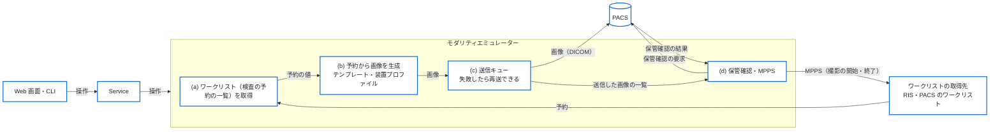
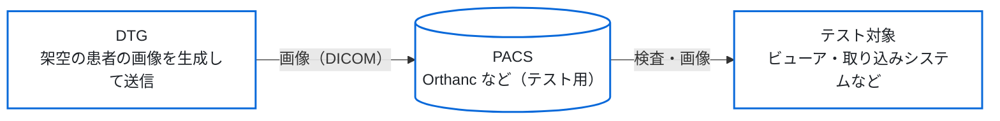

# 構成

## 1. 全体の構成

**UI（Web 画面・CLI・デスクトップ画面）は Service を呼び、Service は Core を
使う。** 依存は上から下への一方向で、逆向きの import はしない。モダリティ
エミュレーターの通信と手順（`app/modality/`）は Service Layer の一部として扱う。

次の図は、DTG の内部と外部のシステム（ワークリストの取得先、PACS）の間で、
データが流れる向きを示す。Web 画面と CLI は同じ Service を呼ぶ。ワークリストの
取得先から予約を受け取り、予約の値でテスト用の画像を生成して、PACS へ送信する。
送信後の保管確認と MPPS は、設定で有効にしたときだけ行う。



テストでは、DTG が PACS へ画像を送信し、ビューアなどのテスト対象がその PACS から
検査と画像を受け取る。PACS は利用者が用意する（Orthanc など）。



## 2. 層

```text
Web (app/web/) ─┐
CLI (app/cli/) ─┤→ Modality (app/modality/) → Service (app/services/)
                │                                   ↓
GUI (app/gui/) ─┴→ Service (app/services/) ──→ Core (app/core/)
```

- UI は Core を直接操作しない。正しくは `CLI → Service Layer → Core Engine`
  で、`CLI → Core Engine` のように Service Layer を経由しない呼び出しはしない。
  これにより、Core は UI に依存せず単体でテストでき、CLI・Web 画面・デスクトップ
  画面が同じ手順を使える
- `app/modality/` は `app/services/` と `app/core/` だけを import する。
  `app/cli/`・`app/web/`・`app/gui/` は import しない
- Core は Pure に保ち、通信・ファイル・ログ・永続化を持たない。予約から生成の
  設定への転記も、通信が不要なので Core に置く
- デスクトップ画面（`app/gui/`）はモダリティエミュレーターを呼ばない
  （[spec/05](spec/05_gui.md)）

`app/modality/` の依存の向き・配置・例外は
[spec/12](spec/12_modality_emulator.md) の 9 章にある。

## 3. ディレクトリ

ファイル名の一覧は書かない。ファイルは増減するので、実際の構成は `ls` で確認する。

| ディレクトリ | 層 | 役割 | spec |
|--------------|----|------|------|
| `app/core/` | Core | Pure な処理。データモデル、UID の生成、ピクセルデータ、File Meta、空間座標、DICOM Dataset の構築、異常値、装置プロファイルの適用、予約の値の転記、文字コード、パスの安全性、例外 | [02](spec/02_core_engine.md)・[03](spec/03_data_models.md)・[08](spec/08_error_handling.md) |
| `app/services/` | Service | 生成の手順（`StudyGeneratorService`）と、テンプレート・患者マスター・装置プロファイルの読み込み | [02](spec/02_core_engine.md)・[13](spec/13_device_profiles.md) |
| `app/modality/` | Service | モダリティエミュレーターの通信と手順。ワークリストの取得、C-STORE・C-ECHO、保管確認、MPPS、送信キューと履歴（sqlite3）、手順をまとめる `ModalityService` | [12](spec/12_modality_emulator.md) |
| `app/cli/` | UI | `python -m app.cli` のエントリポイント。生成・検証・簡易生成と、モダリティエミュレーターの操作 | [04](spec/04_cli.md)・[12a](spec/12a_web_screens_and_cli.md) |
| `app/web/` | UI | `python -m app.web` の Web 画面。FastAPI、ルート（`routes/`）、Jinja2 のテンプレート、静的ファイル | [12a](spec/12a_web_screens_and_cli.md) |
| `app/gui/` | UI | PySide6 のデスクトップ画面。機能は追加しない | [05](spec/05_gui.md) |
| `templates/` | データ | モダリティと病院のテンプレート（YAML） | [07](spec/07_job_schema.md) |
| `profiles/` | データ | 装置プロファイルの例。実在の装置のプロファイルはリポジトリの外に置く | [13](spec/13_device_profiles.md) |
| `config/` | 設定 | `app_config.yaml`（モダリティエミュレーターと Web 画面の設定） | [12](spec/12_modality_emulator.md) の 12 章 |
| `data/` | データ | 患者マスター（架空の患者） | [03](spec/03_data_models.md) |
| `examples/` | 例 | Job YAML の例 | [07](spec/07_job_schema.md) |
| `scripts/` | スクリプト | Web 画面の CSS と静的ファイルを用意するスクリプト、文書の日付を検証するスクリプト | [development.md](development.md) |
| `tests/` | テスト | 層ごとのテスト | [development.md](development.md) |
| `docs/` | 文書 | この文書と spec・ADR | [README](README.md) |

## 4. 生成の流れ

`StudyGeneratorService.generate` が次の順に処理する。CLI と画面で共通である。

1. UID を用意する。Study Instance UID（予約に UID があればそれを使う）、Frame of
   Reference UID などを決める
2. モダリティと病院のテンプレートを読み込んでマージする。病院の `overrides` は
   節の中まで深くマージし、病院が指定しないキーはモダリティの値を残す（浅い
   マージでは Type 2 の Manufacturer が消える。PS3.3 C.7.5.1）。装置プロファイルを
   指定していれば読み込み、テンプレート・Transfer Syntax・文字コードと合うかを
   検証する
3. シリーズごとに Series Instance UID を生成し、画像ごとに次を行う
   1. SOP Instance UID とピクセルデータを生成する
   2. File Meta を生成する
   3. `DICOMBuilder` で Dataset を生成する
   4. テンプレートの属性、予約の値、装置プロファイルの順に重ねる
   5. 異常のデータを適用する（レベルが `none` なら何も変えない）
   6. 画像の文字コードで表現できない文字が無いかを検証する（予約からの撮影は
      `WorklistMappingError`、Job の生成は `DICOMValidationError` で停止する。
      PS3.3 C.12.1・PS3.5 6.1）
   7. 出力フォルダの中にファイルを書き出す（ファイル名は `path_safety` で安全な
      形にする）
4. 完了のログを出力する

## 5. エラーの扱い

```text
Core Engine:
  ↓ 例外を送出する（DICOMGeneratorError の下）
Service Layer:
  ↓ 捕捉してログに出力し、再送出する
UI Layer（CLI・Web 画面・デスクトップ画面）:
  ↓ 捕捉して表示し、終了する（CLI は終了コードで返す）
```

例外の階層と終了コードは [spec/08](spec/08_error_handling.md) にある。

## 6. 依存

依存の正本は `requirements.txt` である。

| 区分 | パッケージ |
|------|-----------|
| DICOM の読み書き | pydicom |
| DICOM の通信 | pynetdicom（MWL・C-STORE・C-ECHO・Storage Commitment・MPPS の SCU） |
| 設定とデータモデル | PyYAML・pydantic（v2） |
| 画像 | Pillow・numpy |
| CLI | tqdm |
| Web 画面 | fastapi・uvicorn・jinja2・python-multipart |
| デスクトップ画面 | PySide6 |
| テスト | pytest・pytest-qt・httpx |

HTMX と、Tailwind CSS で生成する CSS は、バージョンを固定して `scripts/` の
スクリプトで用意する（Python の依存ではない）。Python は 3.10 以上で、CI は 3.10 と
3.12 で実行する。

## 7. セキュリティ

- 入力の検証：Job YAML は Pydantic でスキーマを検証する。ワークリストの応答や UID
  など、相手から来る値は、画像やパスに使う前に形式を検証する
  （[spec/12](spec/12_modality_emulator.md) の 6.5）
- ファイルの出力：パスに使う値は `path_safety` で決まった文字だけにし、出力フォルダ
  の外に書き出せないことを検証する
- Web 画面：既定はループバックだけで待ち受ける。それ以外のアドレスで待ち受ける
  ときはパスワードのファイルが必要（[spec/12a](spec/12a_web_screens_and_cli.md)
  の 10.9）
- 患者のデータは架空で、機密性は無い。ログに Patient ID などが含まれるが、テスト
  環境での使用を前提とする
