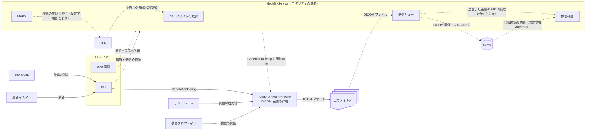

# 構成

## 1. 全体の構成

DTG の主な機能は、架空の患者の架空の検査の DICOM 画像を作成し、出力フォルダに
ファイルとして書き出すことである。補助の機能として、撮影装置（モダリティ）の
ように振る舞う機能（以下、モダリティの機能）を持つ。モダリティの機能は、RIS
（検査の予約を管理するシステム）のワークリスト（撮影の予約の一覧）から予約を
1件選び、予約の値（患者と検査の情報）で画像を作成して、PACS（画像を保管する
システム）へ送信する。予約の値で画像を作成することを撮影と呼ぶ。予約の無い患者
（Web 画面や CLI の引数で入力した患者）でも撮影でき、そのときは入力した値を予約の
値として扱う。コードでは、画像の作成を generate
（`StudyGeneratorService.generate`）、撮影を exam（`ModalityService.exam`）と呼ぶ。

次の図は、DTG の主なモジュールと、モジュールの間でデータが流れる向きを示す。
実線は主な機能、点線はモダリティの機能である。図の C-FIND・C-STORE・MPPS は、
図の後の表で説明する。



図の箱と、それを置くディレクトリは次のとおり。

| 図の箱 | 役割 | ディレクトリ・ファイル | spec |
|--------|------|------------------------|------|
| Job YAML | 患者・検査・シリーズ・ピクセルなどの作成の設定を書くファイル。CLI の `generate` が読み込み、`GenerationConfig` にする | `examples/`（例） | [07](spec/07_job_schema.md) |
| 患者マスター | 架空の患者の一覧。CLI の `quick` が `PatientLoaderService` で読み込む | `data/`・`app/services/patient_loader.py` | [03](spec/03_data_models.md) |
| UI レイヤー | 利用者の操作を受け、結果を表示する。CLI と Web 画面の2つ | 下の2行 | — |
| CLI | `python -m app.cli`。引数の解析は `main.py`、`generate`・`quick` などは `commands.py`、モダリティの機能のコマンド（`exam` など）は `modality_commands.py` | `app/cli/` | [04](spec/04_cli.md)・[12a](spec/12a_web_screens_and_cli.md) の 11 章 |
| Web 画面 | `python -m app.web`。アプリは `app.py`、画面ごとの処理は `routes/`（撮影は `exam.py`）。画像の作成は `ModalityService` だけを経由する | `app/web/` | [12a](spec/12a_web_screens_and_cli.md) の 10 章 |
| テンプレート | モダリティの種類（CT など）と病院ごとの属性の既定値。`TemplateLoaderService` が読み込む | `templates/`・`app/services/template_loader.py` | [07](spec/07_job_schema.md) |
| 装置プロファイル | 実在の装置の DICOM の出力を再現するための属性。`ProfileLoaderService` が読み込む。リポジトリには架空の例だけを置く | `profiles/`・`app/services/profile_loader.py` | [13](spec/13_device_profiles.md) |
| StudyGeneratorService | `GenerationConfig`（作成の設定）と予約の値から DICOM 画像を作成し、出力フォルダに書き出す（3 章） | `app/services/study_generator.py`・`app/core/` | [02](spec/02_core_engine.md)・[06](spec/06_dicom_rules.md) |
| 出力フォルダ | 作成した DICOM ファイルの書き出し先。CLI の `quick` は必須の引数で、`generate` は Job YAML の `output_dir`（`-o` で上書きできる）で指定する。撮影では、設定ファイルの `output_dir`（CLI の `exam` は `-o` でも指定できる）の下に撮影ごとのフォルダを作る | — | [04](spec/04_cli.md)・[12](spec/12_modality_emulator.md) の 12 章 |
| ModalityService | モダリティの機能をまとめるクラス。UI レイヤーから撮影と送信の依頼を受け、下の4つを使い、画像の作成は `StudyGeneratorService` に任せる | `app/modality/service.py` | [12](spec/12_modality_emulator.md) |
| ワークリストの取得 | RIS のワークリストを MWL（Modality Worklist。DICOM の C-FIND で予約を問い合わせるサービス）で取得し、応答を予約（`WorklistItem`）の一覧にする。撮影のときは、`ModalityService.exam` が選んだ予約を予約の値（`ScheduledContext`）にする。予約の値を作る処理と画像の属性にする処理は `app/core/worklist_mapping.py` | `app/modality/worklist_scu.py` | [12](spec/12_modality_emulator.md) の 5・6 章 |
| 送信キュー | DICOM ファイルを C-STORE（DICOM の画像の送信）で PACS へ送信する。状態は SQLite に記録し、失敗した送信は、利用者が再送を指示したとき（CLI の `queue retry`、Web 画面の再送）に送り直す | `app/modality/queue.py`・`store_scu.py` | [12](spec/12_modality_emulator.md) の 8 章 |
| 保管確認 | 保管確認（Storage Commitment）。送信した画像を PACS が保管したかを問い合わせる。Web 画面では送信の成功の後に自動で求め、CLI では `commit` のコマンドで求める。結果は PACS から届くので、受け取るための待ち受け（`CommitmentListener`）も持つ | `app/modality/commitment_scu.py` | [12](spec/12_modality_emulator.md) の 8 章 |
| MPPS | MPPS（Modality Performed Procedure Step）。`ModalityService.exam` が、画像の作成の前に撮影の開始を、後に終了を RIS に通知する。状態は送信キューと同じ SQLite のファイルに、別のキューとして記録し、失敗した通知は `mpps retry` で送り直す | `app/modality/mpps_scu.py`・`mpps_queue.py` | [12](spec/12_modality_emulator.md) の 8 章 |
| RIS・PACS | テストの相手。DTG に含まれず、利用者が用意する（Orthanc など） | — | [usage.md](usage.md) の 4 章 |

図に無いディレクトリは、設定（`config/`）、テスト（`tests/`）、スクリプト
（`scripts/`）、ドキュメント（`docs/`）である。設定ファイルは、モダリティの機能では
`app/modality/config.py`、Web 画面では `app/web/settings.py` が読み込む（設定の
画面の処理は `app/web/routes/settings.py`）。

## 2. モジュールの依存関係

`app/` の下のディレクトリは、3つのレイヤーに分かれる。

| レイヤー | ディレクトリ |
|----------|--------------|
| UI レイヤー | `app/cli/`・`app/web/` |
| Service レイヤー | `app/modality/`・`app/services/`。`app/modality/` が `app/services/` を使い、逆は無い |
| Core レイヤー | `app/core/` |

依存関係は UI → Service → Core の一方向で、次の向きにだけ import する。

```text
app/web/ ──→ app/modality/ ──→ app/services/ ──→ app/core/
app/cli/ ─┬→ app/modality/
          └──────────────────→ app/services/
UI レイヤー ─（データモデル・例外・定数・表示用の関数だけ）→ app/core/
```

- UI レイヤーは、画像の作成を `StudyGeneratorService` か `ModalityService` に
  任せ、`app/core/` の作成のクラス（`DICOMBuilder` など）を直接は呼ばない。
  作成の手順を1か所に置き、CLI と Web 画面で同じ画像になるようにするため。
  `app/core/` のデータモデル（`GenerationConfig` など）・例外・定数
  （`ABNORMAL_LEVELS` など）・表示用の関数（`text_safety.py` の制御文字の可視化
  など）は直接 import してよい
- UI レイヤーのうち `app/services/` を直接使うのは CLI だけである。Job YAML と
  患者マスターからの作成（`generate`・`quick`）は CLI にしか無く、Web 画面は
  撮影だけを行うため
- `app/modality/` は UI レイヤーを import しない。CLI と Web 画面の両方から同じ
  通信の手順を使い、循環 import を避けるため
- `app/core/` は通信・ファイルの読み書き・ログを持たない。ネットワークやファイルを
  用意せずに単体テストできるようにするため。予約の値を画像の属性にする処理も、
  値の変換だけなので `app/core/` に置く

`app/core/` のファイルは [spec/02](spec/02_core_engine.md) の 1・8 章、
`app/modality/` のファイルは [spec/12](spec/12_modality_emulator.md) の 9.3 にある。

## 3. DICOM 画像の作成の流れ

CLI の `generate`・`quick` は、`GenerationConfig` を組み立てて
`StudyGeneratorService.generate` を呼ぶ。撮影（Web 画面の撮影と CLI の `exam`）は
`ModalityService.exam` を経由する。`ModalityService.exam` は、撮影の依頼から
`GenerationConfig` を、予約から予約の値（`ScheduledContext`）を作り、MPPS が
有効なら撮影の開始を通知してから、両方を `generate` に渡す。終わったら撮影の終了
（失敗したときは中止）を通知する。送信は、Web 画面では「撮影して送信」のボタン、
CLI では `exam --send` のときに行う（撮影の後に送信だけを行うこともできる）。

`StudyGeneratorService.generate` は、次の順に処理する。UID・File Meta・Dataset・
Transfer Syntax などの DICOM の規則は [spec/06](spec/06_dicom_rules.md) にある。

1. UID を用意する。Study Instance UID は、予約に UID があればそれを使う。
   Frame of Reference UID などもここで決める
2. テンプレートを重ね、装置プロファイルを検証する
   1. モダリティの種類のテンプレートに、病院のテンプレートの `overrides` を
      ディープマージ（入れ子の辞書もキーごとに統合する）で重ねる。`overrides` の
      節（`general_equipment` など）を節ごと置き換えると、病院のテンプレートが
      書いていない装置の情報（Manufacturer など。値が空でも省けない Type 2 の
      属性。PS3.3 C.7.5.1）まで消えるため
   2. 装置プロファイルを指定していれば読み込み、テンプレート・Transfer Syntax・
      文字コードと合うかを検証する
   3. 廃止された Transfer Syntax を指定していたら拒否する
3. シリーズごとに Series Instance UID を作成し、画像ごとに次を行う
   1. SOP Instance UID とピクセルデータを作成する（`app/core/uid_generator.py` の
      `UIDGenerator`、`pixel_generator.py` の `PixelGenerator`）
   2. File Meta（`dicom_writer.py` の `FileMetaBuilder`）と Dataset
      （`generator.py` の `DICOMBuilder.build_ct_image`。CT の画像の形）を作成する
   3. テンプレートの属性、予約の値（`worklist_mapping.py` の
      `apply_scheduled_context`）、装置プロファイルの属性の順に重ねる
   4. 異常のデータ（あえて規格に違反した値を入れる機能。`abnormal_generator.py`）
      を適用する。一つ前の手順で重ねた値も対象になる（レベルが `none` なら何も
      変えない）
   5. 画像の文字コード（Specific Character Set）で表現できない文字が無いかを
      検証し、あれば停止する。例外は、予約からの作成なら `WorklistMappingError`、
      Job からの作成なら `DICOMValidationError` で、直す場所（RIS の予約か、
      Job・テンプレートの文字コードか）を利用者に示すために分けている
      （PS3.3 C.12.1・PS3.5 6.1）
   6. 出力フォルダにファイルを書き出す。ファイル名は `path_safety.py` で決まった
      文字だけにし、出力フォルダの外に書き出さないことを検証する
4. 完了をログに出力する

## 4. エラーの扱い

- `app/core/` は例外（`DICOMGeneratorError` の下）を送出し、ログは出力しない
- `StudyGeneratorService.generate` は、失敗をログに出力してから再送出する。
  予期しない例外は `GenerationError` に包む
- `app/modality/` は、通信の失敗などを警告のログに残し、例外は呼び出し側へ渡す。
  撮影の途中で作成が失敗したら、MPPS で撮影の中止を通知してから再送出する
- UI レイヤーは捕捉して利用者に表示する。CLI は終了コードでも返す

例外の階層と終了コードは [spec/08](spec/08_error_handling.md)、ログは
[spec/09](spec/09_logging.md) にある。

## 5. 依存するパッケージ

Python のパッケージは `requirements.txt` で管理する。Python は 3.10 以上で動作する。

| 用途 | パッケージ |
|------|-----------|
| DICOM の読み書き | pydicom |
| DICOM の通信 | pynetdicom。MWL・C-STORE・C-ECHO（疎通確認）・保管確認・MPPS の SCU（要求を送る側）と、保管確認の結果の待ち受け |
| 設定とデータモデル | PyYAML・pydantic（v2） |
| 画像 | Pillow・numpy |
| CLI | tqdm |
| Web 画面 | fastapi・uvicorn・jinja2・python-multipart |
| テスト | pytest・httpx |

Web 画面の JavaScript（htmx）と CSS（Tailwind CSS で作成）は Python の
パッケージではない。バージョンを固定して `scripts/` のスクリプトで用意する
（[development.md](development.md) の 5 章）。

## 6. セキュリティ

- 入力の検証：Job YAML は Pydantic でスキーマを検証する。ワークリストの応答の値や
  UID など、相手から来る値は、画像やパスに使う前に形式を検証する
  （[spec/12](spec/12_modality_emulator.md) の 6.5）
- ファイルの出力：ファイル名に使う文字を限り、出力フォルダの外に書き出さない
  （3 章の手順 3 の 6）
- Web 画面：既定はループバック（同じマシンからの接続）だけで待ち受ける。それ以外の
  アドレスで待ち受けるときはパスワードのファイルが必要
  （[spec/12a](spec/12a_web_screens_and_cli.md) の 10.9）
- 患者のデータは架空で、機密性は無い。ログに Patient ID などが含まれるが、テスト
  環境での使用を前提とする
