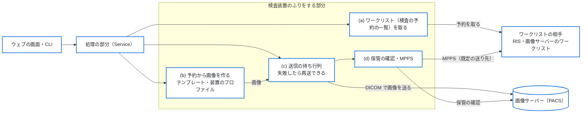
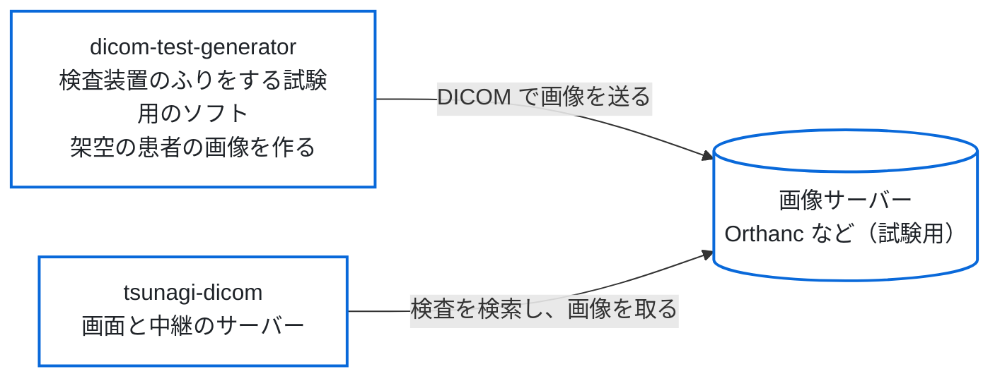

# 01. アーキテクチャ設計

## アーキテクチャ概要

**UI（ウェブの画面・CLI・デスクトップの画面）は Service を呼び、Service は Core を使う。**
依存は上から下の一方向で、逆向きの import はしない。モダリティのダミーの通信と手順
（`app/modality/`）は Service Layer の一部として扱う。層ごとの配置は
「層の構造」と「コンポーネント」に書く。

### システム構成（全体）

この図で分かること：このソフトの中の流れと、外の装置・仕組み（ワークリストの相手、
画像サーバー）とのつながり。

ウェブの画面と CLI は同じ処理の部分（Service）を呼ぶ。ワークリストの相手から予約を取り、
予約の値で試験用の画像を作り、画像サーバー（PACS）へ送る。送った後に、保管の確認と
MPPS を行う。検査装置のふりをする部分の仕様は
[12_modality_emulator.md](12_modality_emulator.md) にある。



### 開発・試験のときの構成（本物の患者のデータを使わずに試す）

この図で分かること：試験のときに、画像を見るソフト（tsunagi-dicom）と組み合わせる構成。



### 層の構造

```text
Web (app/web/) ─┐
CLI (app/cli/) ─┤→ Modality (app/modality/) → Service (app/services/)
                │                                   ↓
GUI (app/gui/) ─┴→ Service (app/services/) ──→ Core (app/core/)
```

- `app/modality/` は `app/services/` と `app/core/` だけを import する。
  `app/cli/`・`app/web/`・`app/gui/` を import しない
- Core は Pure に保つ。通信・ファイル・ログ・永続化を持たない
  （予約から生成の設定への写し方も、通信が要らないので Core に置く）
- デスクトップの画面（`app/gui/`）は凍結していて、モダリティのダミーを呼ばない
  （[05_gui.md](05_gui.md)）

### 設計原則

UI は Core を直接操作しない。

- 正: `CLI → Service Layer → Core Engine`
- 誤: `CLI → Core Engine`（Service Layer をバイパス）

これにより次が成り立つ。

- Core Engine は UI 非依存で、単体で試験できる
- Service Layer に共通の手順を集約できる
- CLI・ウェブの画面・デスクトップの画面で同じ手順を再利用できる

層の決めの詳細（`app/modality/` の依存の向き、配置、例外）は
[12_modality_emulator.md](12_modality_emulator.md) の 9 章にある。

---

## コンポーネント

ディレクトリごとの役割を次に示す。ファイル名の一覧は書かない。ファイルは増減する
ので、実体は `ls` で確かめる。

| ディレクトリ | 層 | 役割 | 仕様 |
|--------------|----|------|------|
| `app/core/` | Core | Pure な処理。データモデル、UID の生成、ピクセルデータ、File Meta、空間座標、DICOM Dataset の構築、異常値、装置のプロファイルの適用、予約の写し方、文字コード、パスの安全、例外 | [02](02_core_engine.md)・[03](03_data_models.md)・[08](08_error_handling.md) |
| `app/services/` | Service | 生成の手順（`StudyGeneratorService`）と、テンプレート・患者マスター・装置のプロファイルの読み込み | [02](02_core_engine.md)・[13](13_device_profiles.md) |
| `app/modality/` | Service | モダリティのダミーの通信と手順。ワークリストの取得、C-STORE・C-ECHO、保管の確認、MPPS、送信の待ち行列と履歴（sqlite3）、手順をまとめる `ModalityService` | [12](12_modality_emulator.md) |
| `app/cli/` | UI | `python -m app.cli` の入口。生成・検証・簡易生成と、モダリティのダミーの操作 | [04](04_cli.md)・[12a](12a_web_screens_and_cli.md) |
| `app/web/` | UI | `python -m app.web` のウェブの画面。FastAPI、画面の経路（`routes/`）、Jinja2 のテンプレート、静的ファイル | [12a](12a_web_screens_and_cli.md) |
| `app/gui/` | UI（凍結） | PySide6 のデスクトップの画面。メインウィンドウ、ウィジェット、生成のワーカースレッド | [05](05_gui.md) |
| `templates/` | データ | モダリティと病院のテンプレート（YAML） | [07](07_job_schema.md) |
| `profiles/` | データ | 装置のプロファイルの例。実在の装置の写しはリポジトリの外に置く | [13](13_device_profiles.md) |
| `config/` | 設定 | `app_config.yaml`（モダリティのダミーとウェブの画面の設定） | [12](12_modality_emulator.md) の 12 章 |
| `data/` | データ | 患者マスター（架空の患者） | [03](03_data_models.md) |
| `examples/` | 例 | Job YAML の例 | [07](07_job_schema.md) |
| `scripts/` | 道具 | ウェブの画面の CSS と静的ファイルを用意するスクリプト | [12a](12a_web_screens_and_cli.md) |
| `tests/` | 試験 | 試験（下の「試験の構成」） | |

---

## データフロー

### 生成フロー（CLI・画面共通）

`StudyGeneratorService.generate` が次の順に行う。

1. UID の準備：Study Instance UID（予約に UID があればそれ）、Frame of
   Reference UID などを決める
2. モダリティと病院のテンプレートを読み込んでマージする。装置のプロファイルを
   指定していれば読み込み、テンプレート・Transfer Syntax・文字コードと合うかを
   確かめる
3. シリーズごとに Series Instance UID を作り、画像ごとに次を行う
   1. SOP Instance UID とピクセルデータを作る
   2. File Meta を作る
   3. `DICOMBuilder` で Dataset を作る
   4. テンプレートの属性、予約の値、装置のプロファイルの順に重ねる
   5. 予約から撮るときは、画像の文字コードで表せない字が無いかを確かめる
   6. 出力のフォルダの中にファイルを書く（名前は `path_safety` で安全にする）
4. 完了のログを出す

### エラーハンドリング

```text
Core Engine:
  ↓ 例外を発生させる（DICOMGeneratorError の下）
Service Layer:
  ↓ 捕まえてログに出し、再送出する
UI Layer（CLI・ウェブの画面・デスクトップの画面）:
  ↓ 捕まえて表示し、終了する（CLI は終了コードで返す）
```

例外の階層と終了コードは [08_error_handling.md](08_error_handling.md) にある。

---

## 依存関係管理

依存の正本は `requirements.txt` である。

| 区分 | パッケージ |
|------|-----------|
| 生成 | pydicom・PyYAML・pydantic・Pillow・numpy |
| DICOM の通信 | pynetdicom |
| CLI | tqdm |
| ウェブの画面 | fastapi・uvicorn・jinja2・python-multipart |
| デスクトップの画面（凍結） | PySide6 |
| 試験 | pytest・pytest-qt・httpx |

HTMX と Tailwind CSS で作る CSS は、固定した版を `scripts/` のスクリプトで用意する
（Python の依存ではない）。

---

## 試験の構成

試験は層に合わせてディレクトリを分ける。

| ディレクトリ | 対象 |
|--------------|------|
| `tests/core/` | Core の各モジュール（単体） |
| `tests/services/` | Service（テンプレート・患者・装置のプロファイル・生成） |
| `tests/cli/` | CLI のサブコマンド |
| `tests/modality/` | `app/modality/`（通信は試験の中の偽の相手に対して行う） |
| `tests/web/` | ウェブの画面（FastAPI の TestClient） |
| `tests/gui/` | デスクトップの画面（Qt の offscreen） |
| `tests/integration/` | 層をまたぐ流れ（予約から送信まで） |

試験の中の偽の相手（ワークリストや PACS の役）は `tests/modality_peers.py` に置く。
CI の流し方は `WORKFLOW.md` にある。

---

## セキュリティ考慮事項

- 入力の検証：Job YAML は Pydantic でスキーマを検証する。ワークリストの応答や
  UID など、相手から来る値は、そのまま画像やパスに使う前に形を確かめる
  （[12_modality_emulator.md](12_modality_emulator.md) の 6 章）
- ファイル出力：パスに使う値は `path_safety` で決まった字だけにし、出力のフォルダの
  外に書けないことを確かめる
- ウェブの画面：既定は手元（ループバック）だけで待ち受ける。手元の外で待ち受ける
  ときはパスワードのファイルを要する
- 機密情報：患者のデータは架空で機密性はない。ログに Patient ID などが入るが、
  試験環境での使用を前提とする

---

## 未実装の候補

- 他モダリティ（MR・CR・DX・US など）。CT だけが実装済み
- Query/Retrieve。範囲外で、`spec/12_modality_emulator.md` に理由を書いた

---

## ADR 参照

設計判断の詳細は以下を参照。

- [ADR-0001: Core Library First](../adr/0001-core-library-first.md)
- [ADR-0002: YAML Job Configuration](../adr/0002-yaml-job-configuration.md)
- [ADR-0003: PySide6 GUI](../adr/0003-pyside6-gui.md)
- [ADR-0006: Threading Model](../adr/0006-threading-model.md)
- [ADR-0009: Phase 1.5 の実装順序](../adr/0009-phase-1_5-ordering.md)
  （ADR-0013 で置き換え。歴史的な記録）
- [ADR-0010: 受信側の運用仕様](../adr/0010-storage-scp-operational-decisions.md)
  （ADR-0013 で置き換え。歴史的な記録）
- [ADR-0011: モダリティのダミーにする](../adr/0011-modality-emulator.md)
- [ADR-0012: 装置のプロファイルで装置の出し方を擬態する](../adr/0012-device-profiles.md)
- [ADR-0013: 受信の機能を外す](../adr/0013-remove-storage-scp.md)
